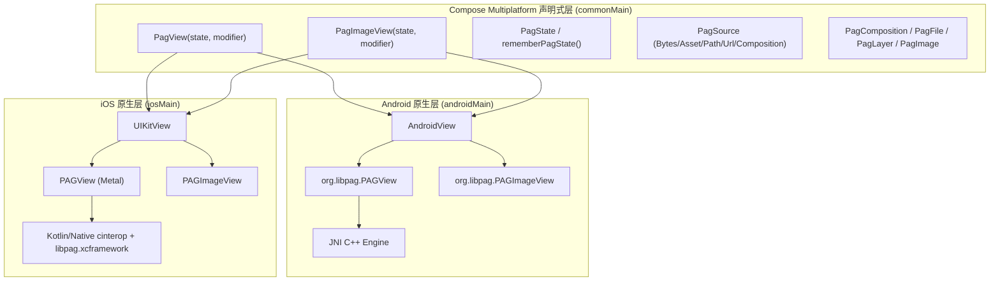

# PagKit: Tencent libpag for Compose Multiplatform (Android + iOS)

[](LICENSE)
[](https://kotlinlang.org)
[](https://www.jetbrains.com/lp/compose-multiplatform/)
[](https://github.com/e-hai/PagKit/packages)

高性能 Tencent **libpag** 动效引擎的 **Kotlin Multiplatform (KMP) + Compose Multiplatform (CMP)** 双端原生互操作封装库，提供纯 Kotlin 声明式 Composable API 与全套控制接口。

---

## 🌟 核心特性

- 🚀 **双端原生硬件加速**：
  - **Android**：基于 `com.tencent.tav:libpag:4.5.102`，通过 `AndroidView` 原生互操作，支持 Surface/Texture GPU 硬件加速；
  - **iOS**：基于官方预编译 `libpag.xcframework`（`v4.5.102`），通过 Kotlin/Native `cinterop` + `UIKitView` 零胶水直连 Metal 硬件渲染管线。
- 🎬 **双视图组件支持**：
  - `PagView`：GPU 实时渲染，专为大尺寸展示、复杂矢量动效、实时动态图文编辑场景打造；
  - `PagImageView`：序列帧位图内存/磁盘缓存渲染，专为 `LazyColumn` / `LazyVerticalGrid` 等高频列表复用性能优化。
- 📦 **统一多数据源 (`PagSource`)**：
  - `PagSource.Bytes`：内存二进制数组（无缝对接 Compose Resources 的 `Res.readBytes(...)`）；
  - `PagSource.Asset`：从 Android Assets 或 iOS App Bundle 加载；
  - `PagSource.FilePath`：从沙盒或本地文件绝对路径加载；
  - `PagSource.Url`：远程 HTTP/HTTPS URL 异步下载加载（内建磁盘缓存）；
  - `PagSource.Composition`：直接挂载自定义多动效合成容器。
- 🎨 **动态图层编辑**：
  - **文本替换**：通过 `PagTextData` 支持文案内容、字号大小、ARGB 填充颜色、描边颜色/粗细、仿粗体/斜体动态替换；
  - **图片替换**：通过 `PagImage.fromBytes` / `PagImage.fromPath` 支持图片占位图动态换入；
  - **图层变换**：透明度（`alpha`）、缩放矩阵（`setScale`）、平移（`setTranslation`）、旋转（`setRotation`）与重置（`resetMatrix`）；
  - **即时刷新**：动态修改图层后支持 `pagState.flush()` 立即触发 GPU 重绘呈现。
- 🧩 **多 PAG 组合与时间轴编排 (`PagComposition`)**：
  - 支持 `PagComposition.make(w, h)` 创建独立合成画布；
  - 动态添加、移除、层级交换（`swapLayerAt`）；
  - 支持子图层时间轴偏移（`startTimeUs`）错峰播放、独立可见性开关（`visible`）。
- ⚡ **离线优先与磁盘缓存 (`PagDiskCache`)**：
  - 自动管理 URL 网络动效的本地磁盘存储；
  - 提供缓存上限设置（`setMaxDiskSize`）与一键清理本地缓存（`removeAll`）。

---

## 🏗️ 架构拓扑



---

## 📦 接入指南

### 1. 添加 Maven 仓库配置

在项目根目录的 `settings.gradle.kts` 中添加 GitHub Packages 源：

```kotlin
dependencyResolutionManagement {
    repositories {
        google()
        mavenCentral()
        maven {
            url = uri("https://maven.pkg.github.com/e-hai/PagKit")
            credentials {
                username = project.findProperty("gpr.user") as String? ?: System.getenv("GITHUB_ACTOR") ?: "e-hai"
                password = project.findProperty("gpr.key") as String? ?: System.getenv("GITHUB_TOKEN")
            }
        }
    }
}
```

> **提示**：若在本地开发未配置环境变量，可将 GitHub Personal Access Token (`read:packages` 权限) 写入用户目录的 `~/.gradle/gradle.properties`：
> ```properties
> gpr.user=your_github_username
> gpr.key=ghp_your_token
> ```

### 2. 引入依赖

在业务共享模块（如 `:composeApp` 或 `:shared`）的 `build.gradle.kts` 中添加：

```kotlin
kotlin {
    sourceSets {
        commonMain.dependencies {
            implementation("io.github.e-hai:pagkit:0.1.0")
        }
    }
}
```

---

## ⚙️ 平台特定配置

### Android 配置

1. **Min SDK 要求**：`minSdk >= 21`。
2. **ProGuard / R8 混淆规则**：
   若开启了 R8 混淆，请在 `proguard-rules.pro` 中保留 libpag 原生类：
   ```proguard
   -keep class org.libpag.** { *; }
   -keep class io.github.pagkit.** { *; }
   ```

### iOS 配置

1. **Info.plist 高刷新率支持（防抖动崩溃）**：
   在 iOS App 的 `Info.plist` 中声明支持手机原生刷新率：
   ```xml
   <key>CADisableMinimumFrameDurationOnPhone</key>
   <true/>
   ```
2. **链接动态库**：
   若使用 CocoaPods 或 Swift Package Manager，确保引入了 `libpag.xcframework`。若通过 XcodeGen / 直接在宿主工程中，将 `pagkit/libpag-ios/libpag.xcframework` 加入 Target 的 **Frameworks, Libraries, and Embedded Content** 并设为 `Embed & Sign`。

---

## 💻 使用示例

### 1. 基础播放控制 (`PagView`)

```kotlin
import androidx.compose.foundation.layout.fillMaxSize
import androidx.compose.runtime.Composable
import androidx.compose.ui.Modifier
import io.github.pagkit.compose.PagView
import io.github.pagkit.compose.rememberPagState
import io.github.pagkit.model.PagScaleMode
import io.github.pagkit.model.PagSource

@Composable
fun SimplePagDemo(pagBytes: ByteArray) {
    // 1. 声明并初始化播放状态
    val state = rememberPagState(
        source = PagSource.Bytes(pagBytes),
        autoPlay = true,
        repeatCount = 0, // 0 表示无限循环，1 表示单次播放
        scaleMode = PagScaleMode.LetterBox
    )

    // 2. 挂载渲染组件
    PagView(
        state = state,
        modifier = Modifier.fillMaxSize(),
        onAnimationStart = { println(">> 动画开始播放") },
        onAnimationEnd = { println(">> 动画播放完成") },
        onAnimationRepeat = { println(">> 动画循环") }
    )

    // 3. 控制接口（可在按钮事件中调用）
    // state.play()       // 开始播放
    // state.pause()      // 暂停播放
    // state.stop()       // 停止并回到起始帧
    // state.seekTo(0.5)  // 精确跳转进度 (0.0 .. 1.0)
}
```

---

### 2. 动态图层编辑 (替换文字与图片)

```kotlin
@Composable
fun DynamicEditDemo(pagBytes: ByteArray) {
    val state = rememberPagState(source = PagSource.Bytes(pagBytes))

    PagView(
        state = state,
        modifier = Modifier.fillMaxSize(),
        onCompositionLoaded = { pagFile ->
            // 1. 动态替换文字图层
            if (pagFile.numTexts > 0) {
                pagFile.replaceText(
                    editableTextIndex = 0,
                    textData = PagTextData(
                        text = "VIP 会员专享",
                        fontSize = 32f,
                        fillColorArgb = 0xFFFFD700.toInt(), // 金色
                        strokeColorArgb = 0xFF000000.toInt(), // 黑色描边
                        strokeWidth = 2f,
                        fauxBold = true
                    )
                )
            }

            // 2. 动态替换图片占位（支持 commonMain 跨平台及两端原生直接替换）
            if (pagFile.numImages > 0) {
                // 通用跨平台方式：从绝对路径或 ByteArray 二进制构建
                val newImage = PagImage.fromPath("/data/user/0/avatar.png")
                // Android 原生扩展：PagImage.fromBitmap(bitmap)
                // iOS 原生扩展：PagImage.fromUIImage(uiImage) / PagImage.fromCGImage(cgImage)
                pagFile.replaceImage(0, newImage)
            }

            // 3. 动态调整图层透明度与缩放
            pagFile.alpha = 0.9f
            pagFile.setScale(1.1f, 1.1f)

            // 4. 强制刷新当前帧渲染呈现
            state.flush()
        }
    )
}
```

---

### 3. 多 PAG 组合与时间轴编排 (`PagComposition`)

```kotlin
fun createMultiLayerComposition(file1Bytes: ByteArray, file2Bytes: ByteArray): PagComposition {
    val layer1 = PagFile.loadFromBytes(file1Bytes)!!
    val layer2 = PagFile.loadFromBytes(file2Bytes)!!

    // 创建 720x720 合成画布
    val composition = PagComposition.make(width = 720, height = 720)

    // 图层 1：左移、0.8 倍缩放
    layer1.setScale(0.8f, 0.8f)
    layer1.setTranslation(-100f, 0f)

    // 图层 2：右移、延迟 600ms 错峰入场
    layer2.setScale(0.8f, 0.8f)
    layer2.setTranslation(100f, 0f)
    layer2.startTimeUs = 600_000L // 600,000 微秒

    // 装载到合成画布
    composition.addLayer(layer1)
    composition.addLayer(layer2)

    return composition
}

// 在 Composable 中装载
val pagState = rememberPagState(source = PagSource.Composition(myComposition))
PagView(state = pagState, modifier = Modifier.fillMaxSize())
```

---

### 4. 列表高性能复用 (`PagImageView`)

```kotlin
@Composable
fun FastListDemo(urls: List<String>) {
    LazyColumn {
        items(urls) { url ->
            val itemState = rememberPagState(
                source = PagSource.Url(url),
                autoPlay = true,
                repeatCount = 0
            )
            PagImageView(
                state = itemState,
                modifier = Modifier.size(80.dp),
                cacheAllFramesInMemory = true // 开启序列帧位图缓存，极速复用不抢占 GPU
            )
        }
    }
}
```

---

## 🛠️ 本地构建与验证

### 1. 跨平台单元测试
```bash
./gradlew :pagkit:testDebugUnitTest :pagkit:iosSimulatorArm64Test
```

### 2. Android 演示应用打包
```bash
./gradlew :sample:androidApp:assembleDebug
```

### 3. iOS 演示应用生成与构建
```bash
# 生成 iOS Framework
./gradlew :sample:shared:linkDebugFrameworkIosSimulatorArm64

# 生成 Xcode 工程并编译
cd sample/iosApp
xcodegen generate
xcodebuild -project iosApp.xcodeproj -scheme iosApp -destination 'generic/platform=iOS Simulator' build CODE_SIGNING_ALLOWED=NO
```

---

## 🚀 发布到 GitHub Packages

### 方式一：GitHub Actions 自动化发布（推荐）

为当前分支打上版本 Tag 并推送至 GitHub：
```bash
git tag v0.1.0
git push origin v0.1.0
```
或在 GitHub 仓库中进入 **Actions** -> **Publish to GitHub Packages**，点击 **Run workflow**。CI 环境（macOS-15）会自动构建全平台 Publication 并发布至 GitHub Packages。

### 方式二：本地命令行发布

配置环境变量后执行：
```bash
GITHUB_TOKEN=ghp_your_token ./gradlew :pagkit:publishAllPublicationsToGitHubPackagesRepository
```

---

## ❓ 常见问题与排查 (FAQ)

1. **Q：修改文本、图片或属性后画面未立即变化？**
   - **A**：动画处于暂停（Paused）或停止（Stopped）状态时，底层渲染器不会每帧重绘。修改属性后请务必调用 `state.flush()` 强制立即渲染。
2. **Q：iOS 在 Compose 启动时出现 `PlistSanityCheck` 崩溃？**
   - **A**：CMP 1.8.0 强制检查 Info.plist 中的 `CADisableMinimumFrameDurationOnPhone`。请在 Xcode / Info.plist 中添加 `<key>CADisableMinimumFrameDurationOnPhone</key><true/>`。
3. **Q：在列表使用 `PagView` 出现卡顿或掉帧？**
   - **A**：对于高频列表，推荐使用专为序列帧复用优化的 `PagImageView` 并设置 `cacheAllFramesInMemory = true`，避免多个 Surface/Metal 渲染上下文争抢 GPU 资源。

---

## 📄 License

```
Copyright 2026 PagKit Authors

Licensed under the Apache License, Version 2.0 (the "License");
you may not use this file except in compliance with the License.
You may obtain a copy of the License at

    http://www.apache.org/licenses/LICENSE-2.0
```
Tencent libpag 归腾讯公司开源版权所有。详情参见 [libpag 官方仓库](https://github.com/tencent/libpag)。
